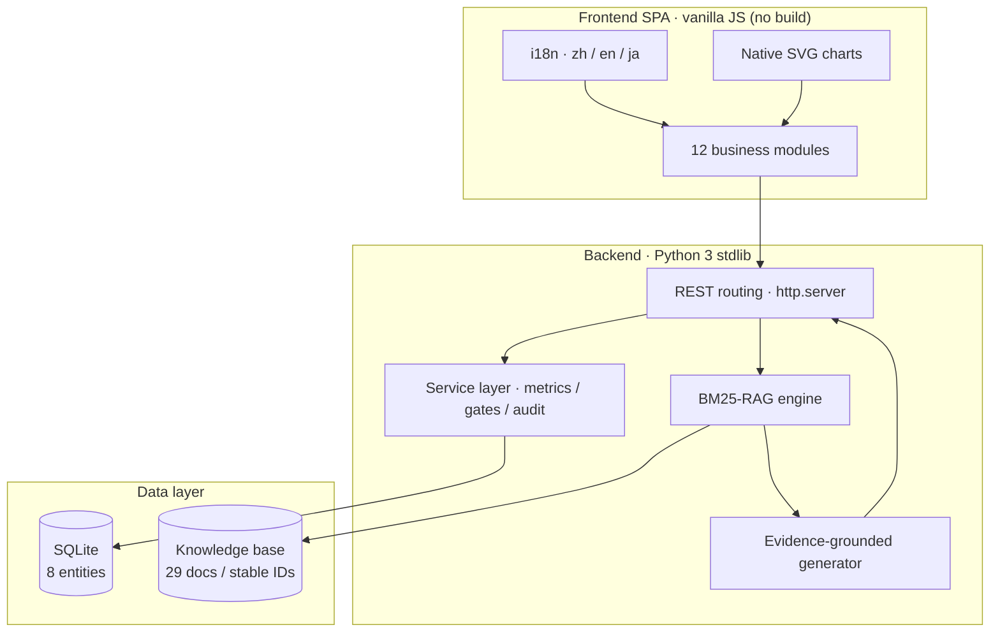

<div align="center">

# TestPilot Enterprise

**An enterprise-grade test management platform — a full lifecycle from requirements to defects, with an evidence-grounded RAG engine for test case generation**


[简体中文](README.md) · [English](README.en.md) · [日本語](README.ja.md)

[**🔗 Live Demo**](https://jhlking.github.io/testpilot-ai/) · [Capabilities](#-capability-matrix) · [Architecture](#-architecture) · [Quick Start](#-quick-start) · [API Reference](#-rest-api-reference) · [v2.0 Changelog](#-v200-changelog)

</div>

---

## 📌 What is this

TestPilot Enterprise is not another "AI writes a few test cases" demo. It is a **runnable QA platform that covers the real workflow of a test team**:

> **Project → Requirement → Test Case → Test Plan → Execution → Defect → Quality Report → Audit**
> Data is connected end to end, and every step carries quality metrics and an audit trail.

It also addresses the most practical problem when adopting AI in QA: **hallucinated test cases**. The built-in generation engine uses Retrieval-Augmented Generation (RAG). **Every generated case must bind to source text in the knowledge base as evidence.** When evidence is insufficient, the system refuses to generate instead of making things up.

**Zero third-party dependencies**: the backend uses only the Python standard library (`http.server` + `sqlite3`), and the frontend is vanilla JavaScript. Reviewers can `clone` and run it with a single command — no environment setup, API keys, or network access required.

---

## 🚀 Live Demo

| Entry | URL | Notes |
|---|---|---|
| Main app | https://jhlking.github.io/testpilot-ai/ | Full UI with browser-side persistence |
| One-click generation | [.../?gen=pay](https://jhlking.github.io/testpilot-ai/?gen=pay) | Prefills a payment requirement and generates cases |
| Chinese UI | [.../?lang=zh](https://jhlking.github.io/testpilot-ai/?lang=zh) | 简体中文 |
| Japanese UI | [.../?lang=ja](https://jhlking.github.io/testpilot-ai/?lang=ja) | 日本語 |

> The demo runs in a pure frontend mode with data stored in `localStorage`. Create, edit, review, execute, and defect transitions all work, and data survives a refresh. When run locally, it switches to SQLite server mode automatically.

---

## 🧩 Capability Matrix

### Test management lifecycle

| Module | Capabilities | Key design |
|---|---|---|
| **Quality Dashboard** | Cross-project KPIs, quality gates, execution trend, defect distribution, project health | See at a glance whether you can release |
| **Projects** | Multiple projects, priority, owner, health | Cascade delete — no orphan data |
| **Requirements** | Code, source, priority, review status, case traceability | Requirement coverage is a core metric |
| **Test Cases** | 9 case types, review workflow, execution status, citations, CSV export | Draft / Reviewed / Approved |
| **Test Plans** | Scope, period, owner, case selection, progress and pass rate | Progress = executed / planned |
| **Execution** | Record actual results; one-click failure-to-defect | Execution writes back case status |
| **Defects** | Kanban workflow, severity, lifecycle | New → Fixed → Reopened / Closed |
| **RAG Studio** | Retrieval, evidence panel, generation, bulk import | Four anti-hallucination gates |
| **Knowledge Base** | 29 enterprise QA documents, categories, stable KB-IDs | Every citation is traceable |
| **Quality Report** | Gates, type distribution, defect distribution, metrics, PDF | Basis for release decisions |
| **Audit Log** | Every write operation recorded (actor / object / time / IP) | Compliance and traceability |
| **Settings** | Language, role, engine, storage mode, team, reset | Demo and operations entry |

### Internationalization (zh / en / ja)

All UI copy is available in three languages. Switching takes effect immediately and is remembered in `localStorage`. Business data (project names, case content) stays in its original language, as is standard for enterprise systems.

- Language switcher in the top bar: `中 / EN / 日`
- Deep links: `?lang=en`, `?lang=ja`
- Adding a language only requires appending a dictionary in `web/i18n.js`

### Case generation engine

Nine case types are composed automatically based on requirement semantics:

`Positive` · `Negative` · `Boundary` · `Validation` · `Security` · `Business Flow` · `Idempotency` · `Performance` · `Data Consistency`

---

## 🛡️ Why it is not "just another AI generator": four anti-hallucination gates

| # | Mechanism | Implementation |
|---|---|---|
| **01** | **No evidence, no output** | Gating on **absolute BM25 score** (not relative). Below the threshold the request is refused with a clear explanation |
| **02** | **Traceable citations** | Every case binds `citations`: KB-ID plus source text, expandable in the UI |
| **03** | **Quantified confidence** | Normalized BM25 score per case; average confidence appears on the dashboard |
| **04** | **Human review for weak cases** | Cases below the confidence threshold are flagged `needs_review` and queued for review |

> **A real design lesson**: v1 used a *relative* score (`score / max_score`) as the refusal gate, which made the top-1 result always 1.0 — even garbage input passed. A unit test caught this genuine defect. v2 switched to an absolute-score gate and added regression tests. That story itself is a solid piece of evidence for test-driven development.

---

## 🏗️ Architecture



**Layer responsibilities**

| Layer | File | Responsibility |
|---|---|---|
| Data | `engine/store.py` | SQLite schema, CRUD for 8 entities, cascade delete, metric aggregation, CSV export |
| Seed | `engine/seed.py` | 3 projects / 7 requirements / 15 cases / 3 plans / 11 executions / 5 defects / 6 audit logs |
| Retrieval | `engine/rag.py` | Chinese bigram + English tokenization, BM25, absolute-score gate |
| Generation | `engine/generator.py` | Signal detection, 9 case templates, evidence binding, confidence aggregation |
| Service | `server.py` | REST routing, static assets, actor header, execution/defect linkage |
| Presentation | `web/` | 12 views, i18n, charts, drawer/modal/toast |
| Static demo | `tools/gen_standalone.py` | Generates `standalone.js` from corpus + seed so both modes stay in sync |

---

## 🧰 Tech Stack

| Category | Choice | Notes |
|---|---|---|
| Language | Python 3.8+ | Backend and tests |
| Web server | `http.server.ThreadingHTTPServer` | Stdlib — no Flask/FastAPI |
| Database | `sqlite3` | Stdlib, file-based, zero setup |
| Retrieval | Custom BM25 | K1=1.5, B=0.75; Chinese bigram + English words |
| Frontend | Vanilla HTML/CSS/JS | No framework, no build, no CDN |
| Charts | Native SVG / conic-gradient | No chart library |
| Testing | `unittest` | 58 tests including API integration |
| i18n | Custom dictionary + `data-i18n` | 3 languages, localStorage persistence |
| Deployment | Local / GitHub Pages | Server mode + static mode |

---

## ⚡ Quick Start

### 1. Clone and run

```bash
git clone https://github.com/jhlking/testpilot-ai.git
cd testpilot-ai

# No pip install, no virtualenv
python server.py
```

Open **http://127.0.0.1:8765** — the database is created and seeded with enterprise demo data on first launch.

```
==============================================================
  TestPilot Enterprise  ·  Enterprise Test Management Platform
==============================================================
  Version:  v2.0.0
  Engine:   BM25-RAG v2 (pure Python stdlib, offline)
  Storage:  SQLite  |  Knowledge: 29 documents
  Demo:     3 projects / 7 requirements / 15 cases
  Serving:  http://127.0.0.1:8765
==============================================================
```

### 2. Run the tests

```bash
python -m unittest discover -s tests -v
# Ran 58 tests ... OK
```

### 3. Call the API

```bash
# Generate test cases
curl -X POST http://127.0.0.1:8765/api/generate \
  -H "Content-Type: application/json" \
  -d '{"title":"Payment","requirement":"Create a payment order; amount > 0; duplicate idempotency key returns the same order; invalid signature returns 401"}'

# Quality dashboard
curl http://127.0.0.1:8765/api/dashboard

# Export cases as CSV
curl -o cases.csv http://127.0.0.1:8765/api/cases/export.csv
```

### 4. Environment variables

| Variable | Default | Description |
|---|---|---|
| `PORT` | `8765` | Server port |
| `TP_DB_PATH` | `data/testpilot.db` | Database path (for test isolation) |

---

## 📖 REST API Reference

All write operations accept an `X-Actor` header to identify the operator and automatically write an audit log entry.

### System & engine

| Method | Path | Description |
|---|---|---|
| GET | `/api/health` | Health check (version, knowledge size, storage mode) |
| GET | `/api/stats` | Knowledge base statistics |
| GET | `/api/documents` | All knowledge documents |
| POST | `/api/search` | BM25 search `{query, top_k}` |
| POST | `/api/generate` | Case generation `{title, requirement}` |
| GET | `/api/dashboard?project_id=` | Quality dashboard (gates, trend, distribution) |

### Entity CRUD

`{entity}` ∈ `projects` · `users` · `requirements` · `cases` · `plans` · `executions` · `defects` · `audit-logs`

| Method | Path | Description |
|---|---|---|
| GET | `/api/{entity}` | List; supports `?project_id=`, `?plan_id=`, `?status=`, `?severity=`, `?limit=` |
| POST | `/api/{entity}` | Create (auto ID, audit entry) |
| GET | `/api/{entity}/{id}` | Detail |
| PATCH | `/api/{entity}/{id}` | Partial update |
| DELETE | `/api/{entity}/{id}` | Delete (project deletion cascades) |

### Business actions

| Method | Path | Description |
|---|---|---|
| GET | `/api/plans/{id}/detail` | Plan detail (cases, executions, progress, pass rate) |
| POST | `/api/execute` | Record a result; optionally auto-create a defect |
| GET | `/api/cases/export.csv` | CSV export (UTF-8 BOM, opens directly in Excel) |

<details>
<summary><b>Example: record an execution and auto-create a defect</b></summary>

```bash
curl -X POST http://127.0.0.1:8765/api/execute \
  -H "Content-Type: application/json" \
  -H "X-Actor: zhang.min" \
  -d '{
    "case_id": "TC-007",
    "plan_id": "PL-001",
    "result": "fail",
    "actual": "Order still shows Paid after payment failure",
    "create_defect": true,
    "defect_title": "Wrong order status after payment failure",
    "severity": "严重"
  }'
```

</details>

---

## 🗃️ Data Model

| Entity | ID | Key fields | Description |
|---|---|---|---|
| `projects` | `P-001` | code, name, priority, owner, status | Test project |
| `requirements` | `R-001` | project_id, code, title, status, source | Requirement |
| `cases` | `TC-001` | project_id, requirement_id, type, priority, steps(JSON), confidence, citations(JSON), review_status, execution_status | Test case |
| `plans` | `PL-001` | project_id, start/end_date, status, owner | Test plan |
| `executions` | `EX-001` | plan_id, case_id, result, actual, executor | Execution record |
| `defects` | `BUG-001` | project_id, case_id, severity, status, assignee | Defect |
| `audit_logs` | `AL-...` | actor, action, entity, detail, ip | Audit log |
| `users` | `U-001` | username, name, role, team | Team member |

---

## 🚦 Quality Gates

Four release gates are built in and shown live on the dashboard and quality report:

| Gate | Target | Formula |
|---|---|---|
| Requirement coverage | ≥ 90% | Requirements with cases / total requirements |
| Case review rate | ≥ 80% | Reviewed or approved cases / total cases |
| Execution pass rate | ≥ 95% | Passed / executed (passed + failed + blocked) |
| Critical/major open defects | = 0 | Severity critical or major, status not closed |

> The demo data intentionally keeps two gates unmet (pass rate 72.7%, 3 major defects open) to demonstrate what a blocked release looks like.

---

## 🧪 Test Report

```
Ran 58 tests in 1.76s
OK
```

| File | Coverage | Tests |
|---|---|---|
| `tests/test_rag.py` | Tokenization, retrieval accuracy, enterprise recall, output structure, 9 case types, hallucination gate | 24 |
| `tests/test_store.py` | CRUD, ID increment, audit, cascade delete, dashboard aggregation, CSV export | 19 |
| `tests/test_api.py` | Real HTTP server: health, full CRUD, execution-to-defect, generation, search, export | 15 |

**Real defects found and fixed during testing**
1. Relative-score gating made the hallucination guard ineffective → switched to an absolute BM25 threshold.
2. Audit IDs were generated from millisecond timestamps and collided under concurrency → added a random suffix.

---

## 📁 Project Structure

```
testpilot-ai/
├── server.py                  # REST entry (routing / static / business linkage)
├── engine/
│   ├── __init__.py
│   ├── rag.py                 # BM25 + tokenizer + absolute gate
│   ├── generator.py           # Evidence-grounded generation (9 types)
│   ├── store.py               # SQLite layer (8 entities / aggregation / audit)
│   └── seed.py                # Enterprise demo data
├── knowledge/
│   └── corpus.json            # Knowledge base (29 docs, stable KB-IDs)
├── web/                       # Frontend source (server mode)
│   ├── index.html
│   ├── style.css
│   ├── app.js                 # 12 views + interactions
│   ├── i18n.js                # zh / en / ja dictionaries
│   └── standalone.js          # Pure frontend engine + data (generated)
├── docs/                      # GitHub Pages static demo (copy of web)
├── tools/
│   └── gen_standalone.py      # Generates standalone.js from corpus + seed
├── tests/
│   ├── test_rag.py
│   ├── test_store.py
│   └── test_api.py
├── data/                      # SQLite database (created at runtime)
├── README.md / README.en.md / README.ja.md
└── LICENSE
```

---

## 🌐 Internationalization

| Language | File | Entry |
|---|---|---|
| 简体中文 | `web/i18n.js` → `I18N.zh` | Default |
| English | `web/i18n.js` → `I18N.en` | `?lang=en` or top-bar EN |
| 日本語 | `web/i18n.js` → `I18N.ja` | `?lang=ja` or top-bar 日 |

To add a language:

1. Append a dictionary to `I18N` in `web/i18n.js` (copy `zh` and translate);
2. Add `{ code, label, short }` to the `LANGS` array;
3. Sync the files to `docs/`.

---

## 🚀 Deployment

### Local / intranet server

```bash
PORT=8080 python server.py
```

### GitHub Pages (static)

```bash
cp web/index.html web/style.css web/app.js web/i18n.js web/standalone.js docs/
git add docs && git commit -m "chore: sync docs" && git push
```

Then set `Settings → Pages` to the `master` branch, `/docs` folder.

### Docker (optional)

```dockerfile
FROM python:3.12-slim
WORKDIR /app
COPY . .
EXPOSE 8765
CMD ["python", "server.py"]
```

---

## 📝 v2.0.0 Changelog

**Added**
- 🏢 Enterprise data layer: SQLite persistence, 8 entities, cascade delete, audit trail
- 🧩 12 business modules: dashboard / projects / requirements / cases / plans / execution / defects / RAG studio / knowledge / reports / audit / settings
- 🌐 i18n: Simplified Chinese, English, Japanese with instant switching
- 📚 Knowledge base expanded from 15 to 29 documents (API, security, performance, process)
- 🎯 Case types expanded from 6 to 9 (idempotency, performance, data consistency)
- 📊 Native SVG line, donut, and graded bar charts
- 🚦 Four quality gates and a quality report
- 📤 CSV export plus Markdown/JSON export
- 🔗 Deep links: `?lang=`, `#view`, `?gen=`

**Improved**
- Table column widths and cell clipping — long text no longer breaks the layout
- Static assets disable caching for immediate feedback during development
- Audit ID uniqueness fixed; concurrent writes supported

**Fixed**
- Relative-score gate made hallucination blocking ineffective → absolute-score gate
- Async ordering issue in modular frontend rendering

---

## 🗺️ Roadmap

- [ ] Integrate a real LLM (keeping RAG evidence constraints and citation validation)
- [ ] Case import (Excel / TestLink / Jira)
- [ ] CI/CD webhook: pipeline results write back execution status
- [ ] RBAC and authentication
- [ ] Test data generator (boundary / equivalence classes)
- [ ] Coverage trend and defect density analysis

---

## 📄 License

[MIT](LICENSE) © jhlking

<div align="center">

**If this project helps you, a Star ⭐ is appreciated**

[简体中文](README.md) · [English](README.en.md) · [日本語](README.ja.md)

</div>
