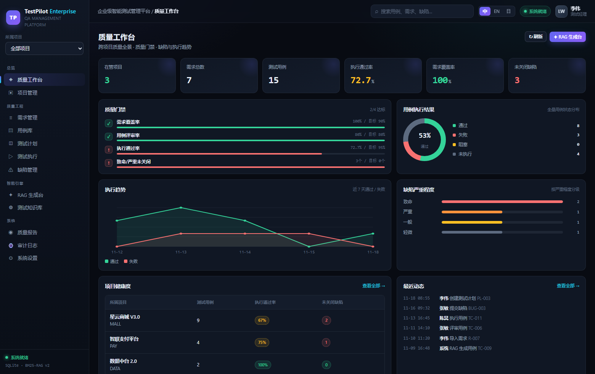
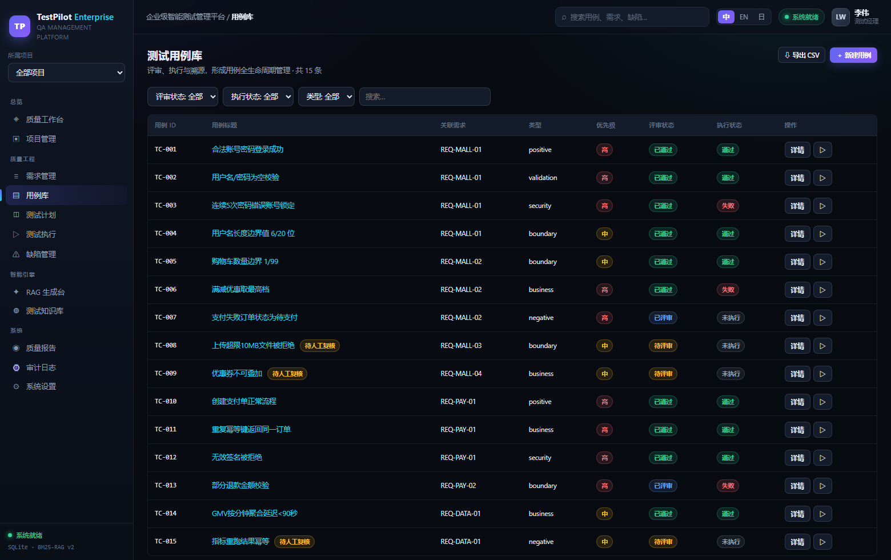
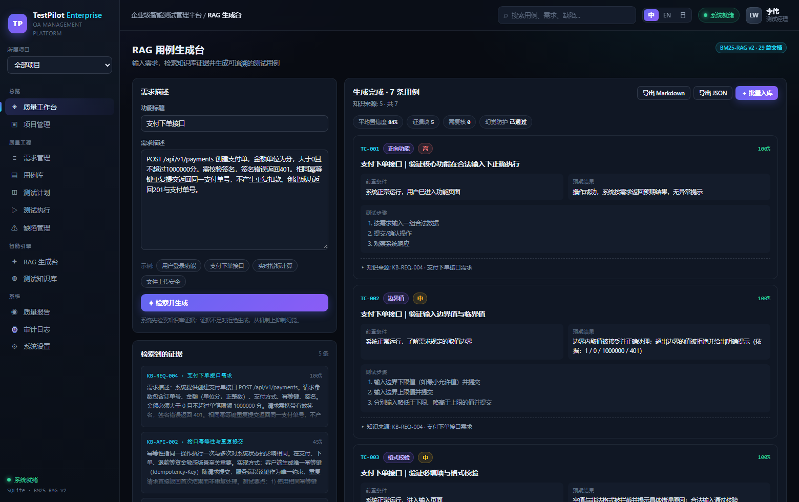
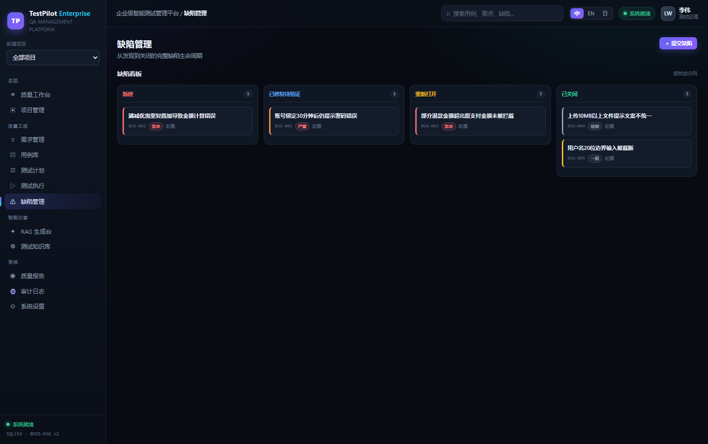
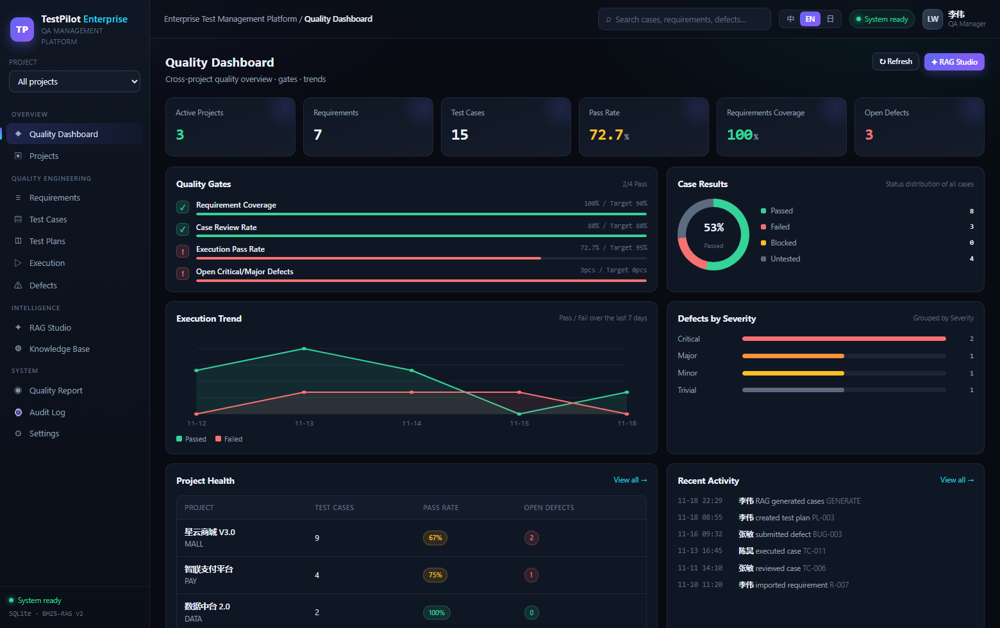
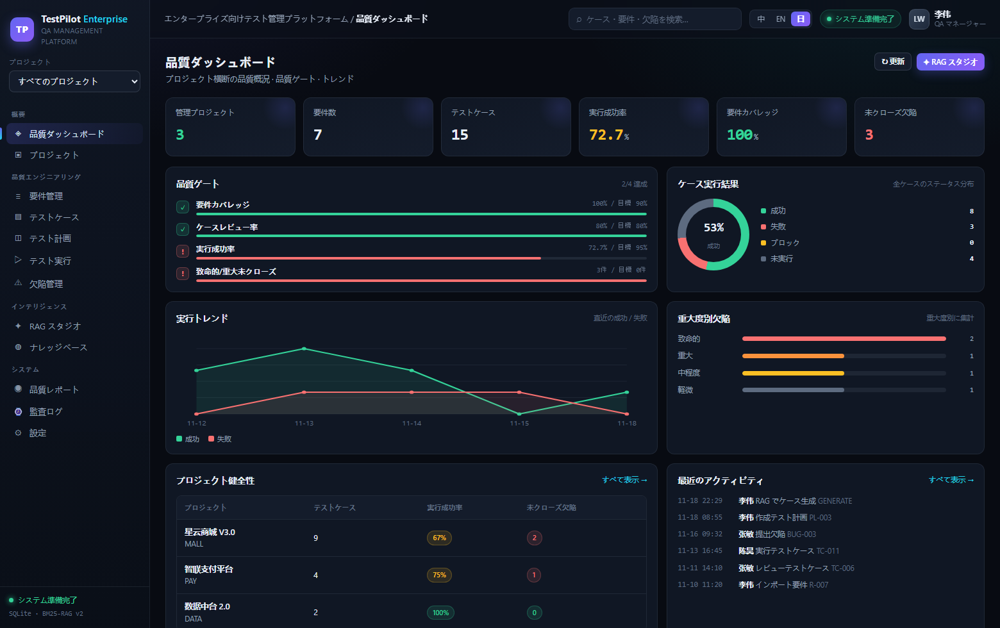
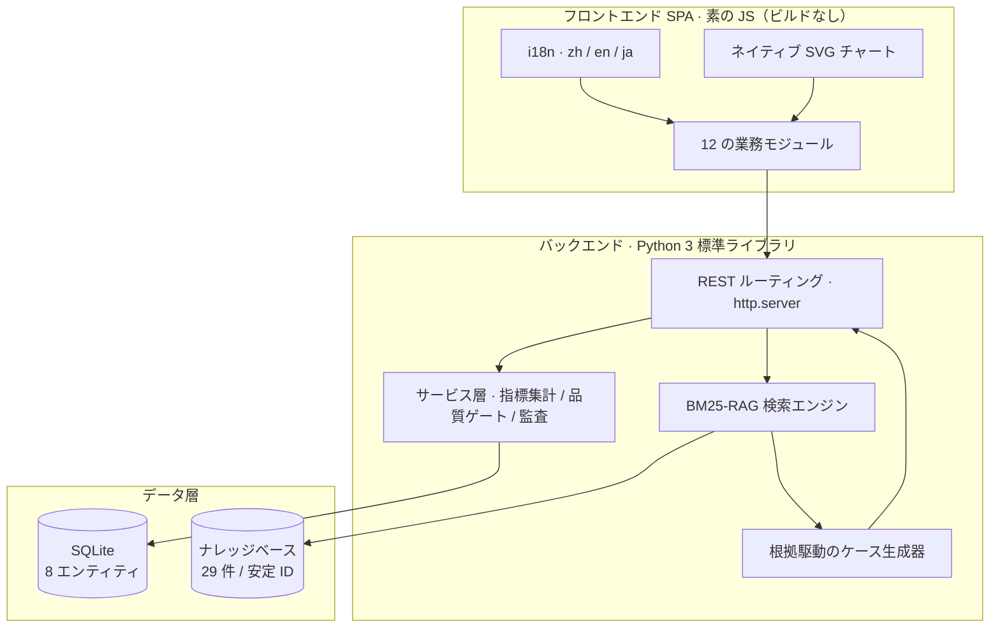

<div align="center">

# TestPilot Enterprise

**エンタープライズ向けテスト管理プラットフォーム — 要件から欠陥までのライフサイクルを一気通貫で管理し、根拠に基づく RAG エンジンでテストケースを生成**


[简体中文](README.md) · [English](README.en.md) · [日本語](README.ja.md)

[**🔗 オンラインデモ**](https://jhlking.github.io/testpilot-ai/) · [機能一覧](#-機能マトリクス) · [アーキテクチャ](#-アーキテクチャ) · [クイックスタート](#-クイックスタート) · [API リファレンス](#-rest-api-リファレンス) · [v2.0 更新履歴](#-v200-更新履歴)

</div>

---

## 📌 これは何か

TestPilot Enterprise は「AI がテストケースを数件生成する」だけのデモではありません。**テストチームの実際の業務フローをカバーする、実行可能な QA プラットフォーム**です。

> **プロジェクト → 要件 → テストケース → テスト計画 → テスト実行 → 欠陥 → 品質レポート → 監査**
> データは最初から最後までつながり、各ステップに品質指標と操作履歴が残ります。

さらに、AI 導入で最も現実的な課題である**ハルシネーション（もっともらしい嘘の生成）**にも対処します。組み込みの生成エンジンは検索拡張生成（RAG）を採用し、**生成されたすべてのケースはナレッジベースの原文に根拠として紐づきます**。根拠が不足している場合、システムはでっち上げずに生成を拒否します。

**サードパーティ依存ゼロ**：バックエンドは Python 標準ライブラリ（`http.server` + `sqlite3`）のみ、フロントエンドは素の JavaScript。レビュー担当者は `clone` して 1 コマンドで起動でき、環境構築・API キー・ネットワークに左右されません。

---

## 🚀 オンラインデモ

| 入口 | URL | 説明 |
|---|---|---|
| メインアプリ | https://jhlking.github.io/testpilot-ai/ | フロントエンド一式＋ブラウザ内データ永続化 |
| ワンクリック生成 | [.../?gen=pay](https://jhlking.github.io/testpilot-ai/?gen=pay) | 決済要件を自動入力してケース生成 |
| 中国語 UI | [.../?lang=zh](https://jhlking.github.io/testpilot-ai/?lang=zh) | 简体中文 |
| 英語 UI | [.../?lang=en](https://jhlking.github.io/testpilot-ai/?lang=en) | English |

> デモは純フロントエンドモードで、データは `localStorage` に保存されます。作成・編集・レビュー・実行・欠陥ステータス変更などの操作が可能で、再読み込みしてもデータは失われません。ローカル実行時は自動的に SQLite サーバーモードに切り替わります。

---


## 📸 画面プレビュー

> スクリーンショットは `tools/shots.py`（Edge + CDP、1560×980 ビューポート）による実描画です。

<table>
<tr>
<td width="50%"><br><sub><b>品質ダッシュボード</b> · プロジェクト横断 KPI、4 つの品質ゲート（2/4 達成 → リリース阻止）、実行トレンド、欠陥重大度</sub></td>
<td width="50%"><br><sub><b>テストケース</b> · 9 種類 15 件、レビュー / 実行状況と優先度を一画面で確認</sub></td>
</tr>
<tr>
<td width="50%"><br><sub><b>RAG スタジオ</b> · 全ケースに引用元と信頼度を付与。根拠の原文をその場で確認</sub></td>
<td width="50%"><br><sub><b>欠陥ボード</b> · 新規 → 修正済・検証待ち → 再オープン → クローズ、重大度で色分け</sub></td>
</tr>
</table>

**3 言語 UI**（同一コードベース、即時切替）：

<table>
<tr>
<td width="50%"><br><sub><b>English</b> · Enterprise Test Management Platform</sub></td>
<td width="50%"><br><sub><b>日本語</b> · エンタープライズ向けテスト管理プラットフォーム</sub></td>
</tr>
</table>

---

## 🧩 機能マトリクス

### テスト管理ライフサイクル

| モジュール | 主な機能 | 設計のポイント |
|---|---|---|
| **品質ダッシュボード** | プロジェクト横断 KPI、品質ゲート、実行トレンド、欠陥分布、健全性 | リリース可否を一目で判断 |
| **プロジェクト** | 複数プロジェクト、優先度、担当者、健全性 | 削除時は関連データを連鎖削除 |
| **要件管理** | 要件番号、出所、優先度、レビュー状態、ケーストレース | 要件カバレッジは中核指標 |
| **テストケース** | 9 種別、レビュー WF、実行状態、根拠参照、CSV 出力 | 下書き / レビュー済 / 承認済 |
| **テスト計画** | 範囲、期間、担当者、ケース割当、進捗と成功率 | 進捗 = 実行済 / 計画ケース |
| **テスト実行** | 実結果の記録、失敗時ワンクリックで欠陥化 | 実行がケース状態に反映 |
| **欠陥管理** | カンバン型 WF、重大度、ライフサイクル | 新規 → 修正済 → 再オープン / クローズ |
| **RAG スタジオ** | 検索、根拠表示、生成、一括登録 | 4 段のハルシネーション防止 |
| **ナレッジベース** | 29 件の QA 知識、カテゴリ検索、安定した KB-ID | 引用は原文まで追跡可能 |
| **品質レポート** | ゲート達成、種別分布、欠陥分布、指標集計、PDF | リリース判断の根拠 |
| **監査ログ** | すべての書き込みを記録（実行者 / 対象 / 時刻 / IP） | コンプライアンスと追跡 |
| **設定** | 言語、ロール、エンジン、保存モード、チーム、リセット | デモと運用の入口 |

### 多言語対応（zh / en / ja）

UI の文言は 3 言語すべてに対応し、切り替えは即時反映され `localStorage` に記憶されます。業務データ（プロジェクト名やケース内容）は元の言語のまま保持されます。これはエンタープライズシステムの慣例に沿った設計です。

- トップバーの言語スイッチャー：`中 / EN / 日`
- ディープリンク：`?lang=en`、`?lang=ja`
- 言語追加は `web/i18n.js` に辞書オブジェクトを追加するだけ

### ケース生成エンジン

要件の意味に応じて 9 種のテストケースを自動構成します。

`正常系` · `異常系` · `境界値` · `入力検証` · `セキュリティ` · `業務フロー` · `冪等性` · `性能・时效` · `データ整合性`

---

## 🛡️ 「よくある AI 生成ツール」ではない理由：4 段のハルシネーション防止

| # | 仕組み | 実装 |
|---|---|---|
| **01** | **根拠なしに生成しない** | **絶対 BM25 スコア**でゲート（相対スコアではない）。閾値未満なら明確な理由とともに拒否 |
| **02** | **引用の追跡可能性** | 各ケースに `citations`（KB-ID と原文）を紐づけ、UI で展開して確認可能 |
| **03** | **信頼度の定量化** | BM25 正規化スコアをケースごとに表示。平均信頼度はダッシュボードに反映 |
| **04** | **低信頼度は人間レビュー** | 閾値未満のケースは `needs_review` としてレビュー待ちに |

> **実際の設計上の教訓**：v1 では拒否ゲートに「相対スコア（score / max_score）」を使っていたため、top-1 が常に 1.0 になり、意味のない入力でも通過していました。この実際の欠陥はユニットテストが検出し、v2 で絶対スコアゲートに変更して回帰テストを追加しました。この経緯自体がテスト駆動開発の格好の証拠になります。

---

## 🏗️ アーキテクチャ



**レイヤー構成**

| レイヤー | ファイル | 役割 |
|---|---|---|
| データ | `engine/store.py` | SQLite スキーマ、8 エンティティの CRUD、連鎖削除、指標集計、CSV 出力 |
| シード | `engine/seed.py` | 3 プロジェクト / 7 要件 / 15 ケース / 3 計画 / 11 実行 / 5 欠陥 / 6 監査 |
| 検索 | `engine/rag.py` | 中国語 bigram + 英語トークン化、BM25、絶対スコアゲート |
| 生成 | `engine/generator.py` | シグナル検出、9 種テンプレート、根拠紐づけ、信頼度集計 |
| サービス | `server.py` | REST ルーティング、静的配信、実行者ヘッダ、実行と欠陥の連携 |
| プレゼン | `web/` | 12 ビュー、i18n、チャート、ドロワー / モーダル / トースト |
| 静的デモ | `tools/gen_standalone.py` | コーパスとシードから `standalone.js` を生成し、両モードを一致させる |

---

## 🧰 技術スタック

| 分類 | 選定 | 説明 |
|---|---|---|
| 言語 | Python 3.8+ | バックエンドとテスト |
| Web サーバー | `http.server.ThreadingHTTPServer` | 標準ライブラリ（Flask / FastAPI 不要） |
| データベース | `sqlite3` | 標準ライブラリ、ファイル型、設定不要 |
| 検索 | 自前 BM25 | K1=1.5、B=0.75、中国語 bigram + 英語語 |
| フロントエンド | 素の HTML/CSS/JS | フレームワーク・ビルド・CDN なし |
| チャート | ネイティブ SVG / conic-gradient | チャートライブラリ不要 |
| テスト | `unittest` | 66 件（API 統合テストとフロントエンドエンジンを含む） |
| 国際化 | 独自辞書 + `data-i18n` | 3 言語、localStorage 記憶 |
| デプロイ | ローカル / GitHub Pages | サーバーモード + 静的モード |

---

## ⚡ クイックスタート

### 1. クローンして起動

```bash
git clone https://github.com/jhlking/testpilot-ai.git
cd testpilot-ai

# pip install も仮想環境も不要
python server.py
```

**http://127.0.0.1:8765** を開きます。初回起動時にデータベースが作成され、企業向けデモデータが投入されます。

```
==============================================================
  TestPilot Enterprise  ·  エンタープライズテスト管理
==============================================================
  バージョン: v2.0.0
  エンジン:   BM25-RAG v2（Python 標準ライブラリのみ、オフライン可）
  ストレージ: SQLite  |  ナレッジ: 29 件
  デモ:      3 プロジェクト / 7 要件 / 15 ケース
  配信:      http://127.0.0.1:8765
==============================================================
```

### 2. テスト実行

```bash
python -m unittest discover -s tests -v
# Ran 66 tests ... OK
```

### 3. API 呼び出し

```bash
# テストケース生成
curl -X POST http://127.0.0.1:8765/api/generate \
  -H "Content-Type: application/json" \
  -d '{"title":"決済","requirement":"決済オーダーを作成。金額は 0 より大きく、冪等キーの重複送信は同一オーダーを返す。署名エラーは 401"}'

# 品質ダッシュボード
curl http://127.0.0.1:8765/api/dashboard

# ケースを CSV 出力
curl -o cases.csv http://127.0.0.1:8765/api/cases/export.csv
```

### 4. 環境変数

| 変数 | 既定値 | 説明 |
|---|---|---|
| `PORT` | `8765` | サーバーポート |
| `TP_DB_PATH` | `data/testpilot.db` | データベースパス（テスト分離用） |

---

## 📖 REST API リファレンス

すべての書き込み操作は `X-Actor` ヘッダで実行者を識別し、自動的に監査ログを記録します。

### システムとエンジン

| メソッド | パス | 説明 |
|---|---|---|
| GET | `/api/health` | ヘルスチェック（バージョン、ナレッジ規模、保存モード） |
| GET | `/api/stats` | ナレッジベース統計 |
| GET | `/api/documents` | ナレッジ全件 |
| POST | `/api/search` | BM25 検索 `{query, top_k}` |
| POST | `/api/generate` | ケース生成 `{title, requirement}` |
| GET | `/api/dashboard?project_id=` | 品質ダッシュボード（ゲート、トレンド、分布） |

### エンティティ CRUD

`{entity}` ∈ `projects` · `users` · `requirements` · `cases` · `plans` · `executions` · `defects` · `audit-logs`

| メソッド | パス | 説明 |
|---|---|---|
| GET | `/api/{entity}` | 一覧。`?project_id=`、`?plan_id=`、`?status=`、`?severity=`、`?limit=` に対応 |
| POST | `/api/{entity}` | 作成（ID 自動採番、監査記録） |
| GET | `/api/{entity}/{id}` | 詳細 |
| PATCH | `/api/{entity}/{id}` | 部分更新 |
| DELETE | `/api/{entity}/{id}` | 削除（プロジェクト削除は連鎖） |

### 業務アクション

| メソッド | パス | 説明 |
|---|---|---|
| GET | `/api/plans/{id}/detail` | 計画詳細（ケース、実行履歴、進捗、成功率） |
| POST | `/api/execute` | 実行結果を記録。失敗時は欠陥を自動作成可能 |
| GET | `/api/cases/export.csv` | ケース一覧の CSV 出力（UTF-8 BOM、Excel で直接開ける） |

<details>
<summary><b>例：実行を記録し欠陥を自動作成</b></summary>

```bash
curl -X POST http://127.0.0.1:8765/api/execute \
  -H "Content-Type: application/json" \
  -H "X-Actor: zhang.min" \
  -d '{
    "case_id": "TC-007",
    "plan_id": "PL-001",
    "result": "fail",
    "actual": "決済失敗後もオーダーが支払済のまま",
    "create_defect": true,
    "defect_title": "決済失敗時のオーダーステータス不整合",
    "severity": "严重"
  }'
```

</details>

---

## 🗃️ データモデル

| エンティティ | ID | 主要フィールド | 説明 |
|---|---|---|---|
| `projects` | `P-001` | code, name, priority, owner, status | テストプロジェクト |
| `requirements` | `R-001` | project_id, code, title, status, source | 要件 |
| `cases` | `TC-001` | project_id, requirement_id, type, priority, steps(JSON), confidence, citations(JSON), review_status, execution_status | テストケース |
| `plans` | `PL-001` | project_id, start/end_date, status, owner | テスト計画 |
| `executions` | `EX-001` | plan_id, case_id, result, actual, executor | 実行記録 |
| `defects` | `BUG-001` | project_id, case_id, severity, status, assignee | 欠陥 |
| `audit_logs` | `AL-...` | actor, action, entity, detail, ip | 監査ログ |
| `users` | `U-001` | username, name, role, team | チームメンバー |

---

## 🚦 品質ゲート

4 つのリリースゲートを搭載し、ダッシュボードと品質レポートにリアルタイムで表示します。

| ゲート | 目標 | 算出方法 |
|---|---|---|
| 要件カバレッジ | ≥ 90% | ケースのある要件 / 全要件 |
| ケースレビュー率 | ≥ 80% | レビュー済または承認済 / 全ケース |
| 実行成功率 | ≥ 95% | 成功 / 実行済（成功 + 失敗 + ブロック） |
| 致命的・重大な未クローズ欠陥 | = 0 | 重大度が致命的または重大で、状態がクローズ以外 |

> デモデータは意図的に 2 つのゲートを未達のまま残しています（成功率 72.7%、重大欠陥 3 件未クローズ）。ゲートでリリースが止まる実際のシナリオを示すためです。

---

## 🧪 テストレポート

```
Ran 66 tests in 1.73s
OK
```

| ファイル | カバレッジ | 件数 |
|---|---|---|
| `tests/test_rag.py` | トークン化、検索精度、企業ナレッジ召回、生成構造、9 種ケース、ハルシネーションゲート | 24 |
| `tests/test_store.py` | CRUD、ID 採番、監査、連鎖削除、ダッシュボード集計、CSV 出力 | 19 |
| `tests/test_api.py` | 実 HTTP サーバー：ヘルス、CRUD 一連、実行から欠陥化、生成、検索、出力、Actor ヘッダ回帰 | 17 |
| `tests/test_standalone.py` | フロントエンド JS エンジン（node 実行）：信頼度の有限性、優先度 enum、タイトル接頭辞、サーバーとの件数一致、ハルシネーション防止 | 6 |

**テストで発見・修正した実際の欠陥**
1. 相対スコアをゲートに使ったためハルシネーション防止が機能していなかった → 絶対 BM25 スコアゲートに変更。
2. 監査 ID をミリ秒タイムスタンプから生成していたため同時実行で主キー衝突 → ランダムサフィックスを追加。
3. **ブラウザからの書き込みが全て無言で失敗**：`X-Actor` ヘッダに中文氏名をそのまま入れたため `fetch` が `non ISO-8859-1 code point` で例外送出。サーバーモードの生成・作成・更新・実行が全滅（画面は一瞬 Toast が出るだけ）。クライアント側 `encodeURIComponent` + サーバー側 `unquote` で修正し、回帰テストを追加。**単体テストも curl も緑で、実ブラウザで一度クリックして初めて露見した欠陥**。
4. **純フロントエンドエンジンが `NaN` の信頼度を出力**：JS 版 `add()` が優先度を信頼度増分の引数に受け取っていたため、冪等性・性能・一貫性のケースが `NaN`、平均信頼度が `null` に。Python 版はキーワード引数なので無事——「実装が二つある」リスクの典型例。修正後、node で JS エンジンを実行しサーバー側と件数を比較する `tests/test_standalone.py` を追加。

---

## 📁 プロジェクト構成

```
testpilot-ai/
├── server.py                  # REST 入口（ルーティング / 静的配信 / 業務連携）
├── engine/
│   ├── __init__.py
│   ├── rag.py                 # BM25 + トークン化 + 絶対スコアゲート
│   ├── generator.py           # 根拠駆動の生成（9 種）
│   ├── store.py               # SQLite 層（8 エンティティ / 集計 / 監査）
│   └── seed.py                # 企業デモデータ
├── knowledge/
│   └── corpus.json            # ナレッジベース（29 件、安定 KB-ID）
├── web/                       # フロントエンド（サーバーモード）
│   ├── index.html
│   ├── style.css
│   ├── app.js                 # 12 ビュー + インタラクション
│   ├── i18n.js                # zh / en / ja 辞書
│   └── standalone.js          # 純フロントエンドエンジン + データ（自動生成）
├── docs/                      # GitHub Pages 静的デモ（build_docs が生成）
│   └── shots/                 # UI スクリーンショット（shots.py で実写）
├── tools/
│   ├── gen_standalone.py      # コーパス + シードから standalone.js を生成
│   ├── build_docs.py          # docs/ を再生成し ?v= を更新
│   └── shots.py               # Edge + CDP による実描画スクリーンショット
├── tests/
│   ├── test_rag.py
│   ├── test_store.py
│   └── test_api.py
├── data/                      # SQLite データベース（実行時生成）
├── README.md / README.en.md / README.ja.md
└── LICENSE
```

---

## 🌐 多言語対応

| 言語 | ファイル | 入口 |
|---|---|---|
| 简体中文 | `web/i18n.js` → `I18N.zh` | 既定 |
| English | `web/i18n.js` → `I18N.en` | `?lang=en` またはトップバー EN |
| 日本語 | `web/i18n.js` → `I18N.ja` | `?lang=ja` またはトップバー 日 |

言語を追加する手順：

1. `web/i18n.js` の `I18N` に辞書を追加（`zh` をコピーして翻訳）；
2. `LANGS` 配列に `{ code, label, short }` を追加；
3. `docs/` にファイルを同期。

---

## 🚀 デプロイ

### ローカル / 社内サーバー

```bash
PORT=8080 python server.py
```

### GitHub Pages（静的）

```bash
cp web/index.html web/style.css web/app.js web/i18n.js web/standalone.js docs/
git add docs && git commit -m "chore: sync docs" && git push
```

リポジトリの `Settings → Pages` で `master` ブランチの `/docs` を選択します。

### Docker（任意）

```dockerfile
FROM python:3.12-slim
WORKDIR /app
COPY . .
EXPOSE 8765
CMD ["python", "server.py"]
```

---

## 📝 v2.0.2 更新履歴

**修正（重要）**
- 🐞 フロントエンド JS エンジンが `NaN` の信頼度を出力：`add()` の呼び出しで優先度（`"高"`/`"中"`）を信頼度の増分引数に渡していたため、冪等性・性能・一貫性のケースが `NaN` になり、平均信頼度が `null` 表示に。Python 側はキーワード引数を使っているため、サーバー側テストは全て緑のまま、純フロントエンドのデモだけが壊れていた。
- 🛡️ `add()` に型ガードを追加し、信頼度と優先度が無言で壊れないように。

**テスト追加**
- `tests/test_standalone.py`（6 件）を追加：node で `standalone.js` を実行し、信頼度が `[0,1]` の有限数か、優先度が正しい enum か、タイトルに機能名接頭辞があるか、**サーバーエンジンとケース件数が一致するか**、根拠なしでハルシネーション防止が働くかを検証。
- テスト合計 60 → 66。

---

## 📝 v2.0.1 更新履歴

**修正（重要）**
- 🐞 ブラウザからの書き込みが全て無言で失敗：`X-Actor` に中文氏名が入り `fetch` が `non ISO-8859-1 code point` で例外。クライアントは `encodeURIComponent`、サーバーは `unquote` で復元し、回帰テストを追加。
- 🐞 生成ケースのタイトルが要件と切り離されていた：機能名を接頭辞に付与（`決済API｜検証…`）し、複数要件が混在しても帰属が分かるように。

**多言語対応の補完**
- 品質ゲート 4 項目の名称と目標単位（个 / pcs / 件）
- 欠陥の重大度（Critical / Major / Minor / Trivial）とステータス（New / Fixed · Pending Verify / Reopened / Closed）
- 監査ログの動作（作成 / 更新 / 削除 / 提出 / レビュー / インポート / 実行）
- ケース優先度バッジ、欠陥ボードの列見出し

**開発体験・ツール**
- `tools/build_docs.py` を追加：`docs/` の静的デモを一括再生成し、内容ハッシュで `?v=` を更新
- `tools/shots.py` を追加：Edge + CDP の実描画スクリーンショット（描画完了ポーリング付き）
- RAG スタジオの待機パネル高さを調整し、2 カラムのバランスを改善
- テスト 58 → 60（API 回帰を 2 件追加）

---

## 📝 v2.0.0 更新履歴

**追加**
- 🏢 企業向けデータ層：SQLite 永続化、8 エンティティ、連鎖削除、監査記録
- 🧩 12 の業務モジュール：ダッシュボード / プロジェクト / 要件 / ケース / 計画 / 実行 / 欠陥 / RAG スタジオ / ナレッジ / レポート / 監査 / 設定
- 🌐 多言語：简体中文・English・日本語、即時切り替え
- 📚 ナレッジベースを 15 件から 29 件に拡充（API・セキュリティ・性能・プロセス）
- 🎯 ケース種別を 6 種から 9 種に拡充（冪等性・性能・データ整合性）
- 📊 ネイティブ SVG によるトレンド・ドーナツ・段階バーチャート
- 🚦 4 つの品質ゲートと品質レポート
- 📤 CSV 出力、Markdown / JSON 出力
- 🔗 ディープリンク：`?lang=`、`#view`、`?gen=`

**改善**
- テーブルの列幅とセル省略表示を調整し、長文でもレイアウトが崩れないように
- 静的アセットのキャッシュを無効化し、開発時の反映を即時に
- 監査ログ ID の一意性を修正し、同時書き込みに対応

**修正**
- 相対スコアゲートによりハルシネーション防止が機能していなかった問題 → 絶対スコアゲート
- フロントエンドのモジュール描画における非同期順序の問題

---

## 🗺️ ロードマップ

- [ ] 実 LLM の統合（RAG の根拠制約と引用検証は維持）
- [ ] ケースのインポート（Excel / TestLink / Jira）
- [ ] CI/CD Webhook：パイプライン結果を実行状態に自動反映
- [ ] RBAC と認証
- [ ] テストデータ生成（境界値・同値クラスの自動構築）
- [ ] カバレッジ推移と欠陥密度分析

---

## 📄 ライセンス

[MIT](LICENSE) © jhlking

<div align="center">

**このプロジェクトが役に立ったら、Star ⭐ をお願いします**

[简体中文](README.md) · [English](README.en.md) · [日本語](README.ja.md)

</div>
