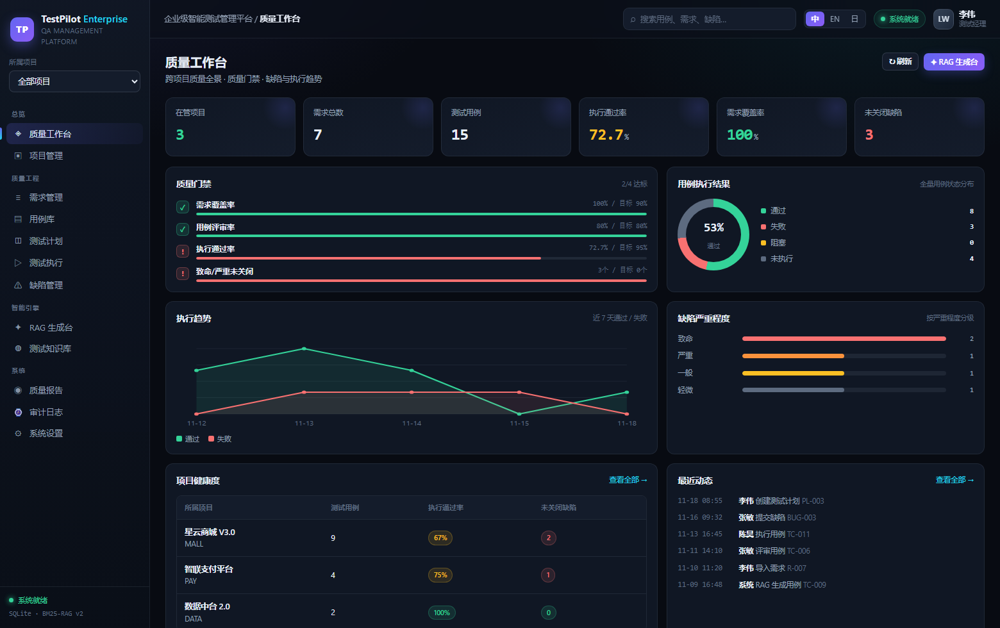
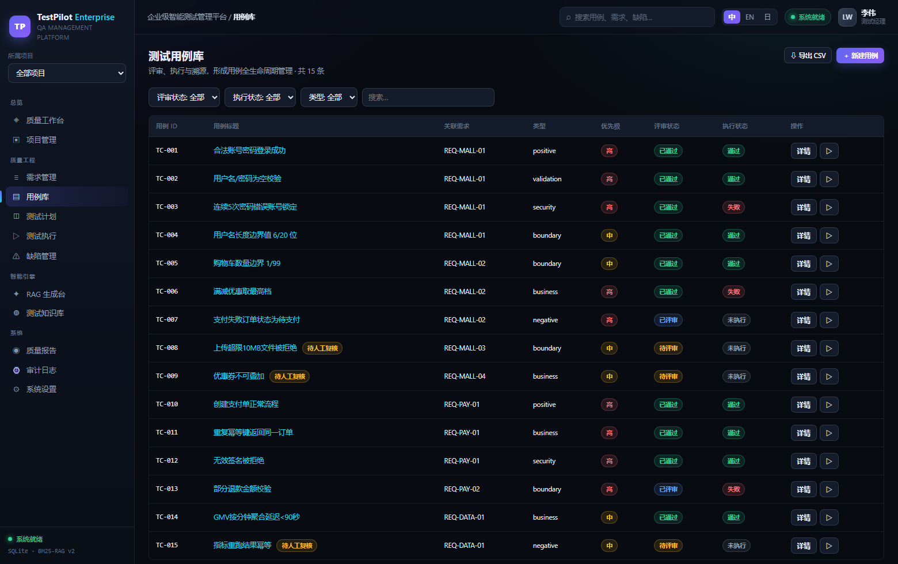
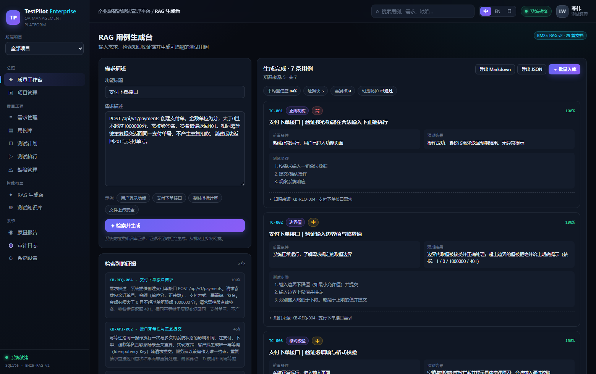
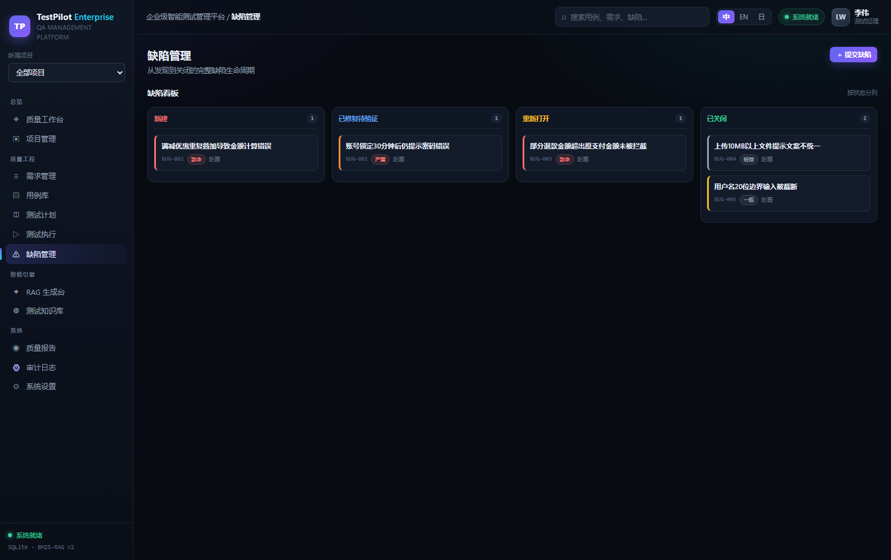
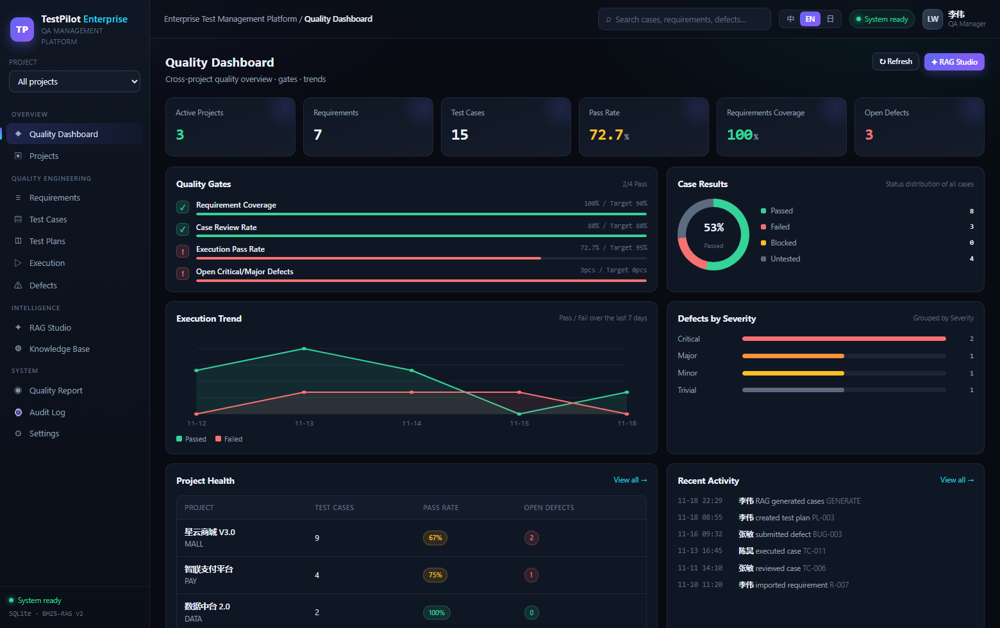
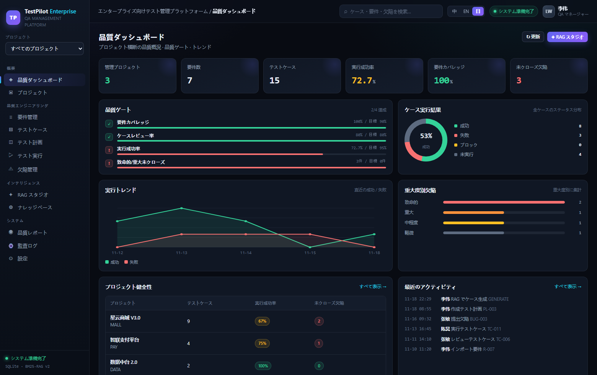
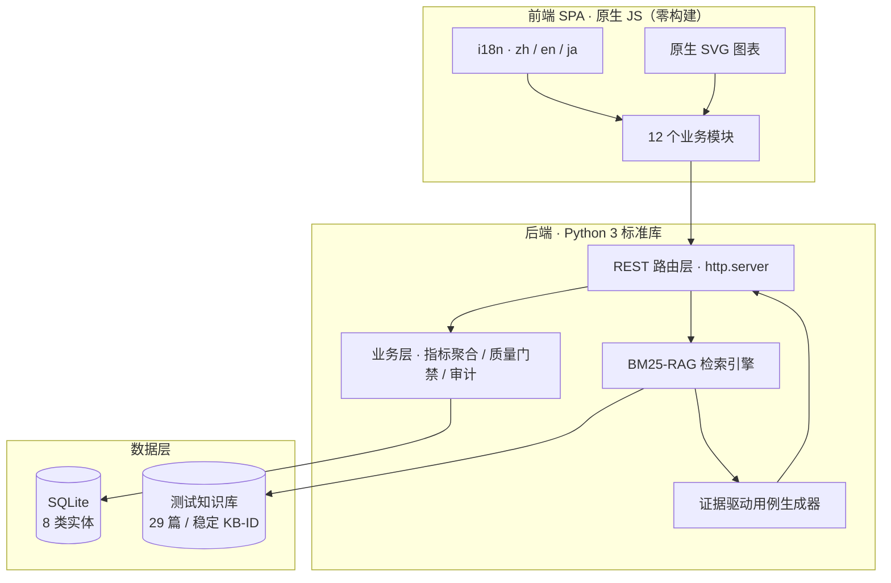

<div align="center">

# TestPilot Enterprise · 智测方舟企业版

**企业级智能测试管理平台 —— 从需求到缺陷的测试全生命周期闭环，内置可溯源的 RAG 用例生成引擎**


[简体中文](README.md) · [English](README.en.md) · [日本語](README.ja.md)

[**🔗 在线演示**](https://jhlking.github.io/testpilot-ai/) · [核心能力](#-核心能力矩阵) · [架构设计](#-系统架构) · [快速开始](#-快速开始) · [API 文档](#-rest-api-文档) · [v2.0 更新](#-v200-更新日志)

</div>

---

## 📌 这是什么

TestPilot Enterprise 不是一个"AI 生成几条测试用例"的玩具 Demo，而是一套**可直接运行、覆盖测试团队真实工作流**的企业级 QA 管理平台：

> **项目 → 需求 → 用例 → 测试计划 → 测试执行 → 缺陷 → 质量报告 → 审计**
> 全链路数据打通，每一步都有质量指标与操作留痕。

它同时解决一个 AI 落地中最现实的问题：**大模型编造测试用例**。平台内置的生成引擎采用检索增强生成（RAG），**每一条用例都必须绑定知识库原文作为证据**；证据不足时，系统直接拒绝生成，而不是编造。

**零第三方依赖**：后端只用 Python 标准库（`http.server` + `sqlite3`），前端原生 JavaScript。评审者 `clone` 后一条命令即可运行，不受环境、API Key、网络限制。

---

## 🚀 在线演示

| 入口 | 地址 | 说明 |
|---|---|---|
| 主应用 | https://jhlking.github.io/testpilot-ai/ | 完整前端 + 浏览器内数据持久化 |
| 一键生成演示 | [.../?gen=pay](https://jhlking.github.io/testpilot-ai/?gen=pay) | 自动填充"支付下单接口"并生成用例 |
| 英文界面 | [.../?lang=en](https://jhlking.github.io/testpilot-ai/?lang=en) | 界面切换 English |
| 日文界面 | [.../?lang=ja](https://jhlking.github.io/testpilot-ai/?lang=ja) | 界面切换 日本語 |

> 演示版为纯前端模式（数据存于浏览器 localStorage），支持新建、编辑、评审、执行、缺陷流转等全部交互，刷新不丢失。本地运行时自动切换为 SQLite 服务端模式。

---

## 📸 界面预览

> 以下截图由 `tools/shots.py` 通过 Edge + CDP 在 1560×980 视口下真实渲染生成，非设计稿。

<table>
<tr>
<td width="50%"><br><sub><b>质量工作台</b> · 跨项目 KPI、四道质量门禁（2/4 达标 → 发布被拦截）、执行趋势、缺陷分级</sub></td>
<td width="50%"><br><sub><b>用例库</b> · 15 条用例覆盖 9 种类型，评审 / 执行状态与优先级一屏可读</sub></td>
</tr>
<tr>
<td width="50%"><br><sub><b>RAG 生成台</b> · 7 条用例全部带证据引用与置信度，左侧可逐条核对知识库原文</sub></td>
<td width="50%"><br><sub><b>缺陷看板</b> · 新建 → 已修复待验证 → 重新打开 → 已关闭，按严重程度着色</sub></td>
</tr>
</table>

**三语界面**（同一份代码，切换即刻生效）：

<table>
<tr>
<td width="50%"><br><sub><b>English</b> · Enterprise Test Management Platform</sub></td>
<td width="50%"><br><sub><b>日本語</b> · エンタープライズ向けテスト管理プラットフォーム</sub></td>
</tr>
</table>

---

## 🧩 核心能力矩阵

### 测试管理闭环

| 模块 | 核心能力 | 关键设计 |
|---|---|---|
| **质量工作台** | 跨项目 KPI、质量门禁、执行趋势、缺陷分布、项目健康度 | 一屏看清"能不能发版" |
| **项目管理** | 多项目并行、优先级、负责人、健康度 | 项目级级联删除，数据不残留 |
| **需求管理** | 需求编号、来源、优先级、评审状态、用例追溯 | 需求覆盖率是核心质量指标 |
| **用例库** | 9 类用例、评审流转、执行状态、知识溯源、CSV 导出 | 待评审 / 已评审 / 已通过三态 |
| **测试计划** | 范围、周期、负责人、用例编排、进度与通过率 | 计划进度 = 已执行 / 计划用例 |
| **测试执行** | 逐条记录实际结果、失败一键转缺陷 | 执行即回写用例状态 |
| **缺陷管理** | 看板式流转、严重程度、生命周期 | 新建 → 修复待验证 → 重开 / 关闭 |
| **RAG 生成台** | 需求检索、证据展示、用例生成、批量入库 | 四道防幻觉闸门 |
| **测试知识库** | 29 篇企业测试知识、分类检索、稳定 KB-ID | 用例引用可回溯原文 |
| **质量报告** | 门禁达成、类型分布、缺陷分布、指标汇总、PDF | 发布决策依据 |
| **审计日志** | 全量写操作留痕（操作人/对象/时间/IP） | 满足合规追溯 |
| **系统设置** | 语言、角色、引擎、存储模式、团队、数据重置 | 演示与运维入口 |

### 多语言支持（zh / en / ja）

界面框架文案全量三语，切换即时生效并记忆到 `localStorage`。业务数据（项目名、用例内容）保持原语言——符合企业系统惯例。

- 顶栏语言切换器：`中 / EN / 日`
- URL 深链参数：`?lang=en`、`?lang=ja`
- 新增语言只需在 `web/i18n.js` 追加一个字典对象

### 用例生成引擎

支持 9 类测试用例，依据需求语义自动组合：

`正向功能` · `异常/反向` · `边界值` · `格式校验` · `安全性` · `业务流程` · `幂等性` · `性能时效` · `数据一致性`

---

## 🛡️ 为什么它不是"又一个 AI 生成器"：四道防幻觉闸门

| # | 机制 | 实现 |
|---|---|---|
| **01** | **无证据不生成** | 用**绝对 BM25 分数**做闸门（而非相对分）。低于阈值直接拒绝，返回明确的 refusal 说明 |
| **02** | **引用可回溯** | 每条用例绑定 `citations`：知识库 KB-ID + 原文，界面可展开核对 |
| **03** | **置信度量化** | BM25 归一化评分，逐条显示；平均置信度进入仪表盘 |
| **04** | **低置信度人工复核** | 低于阈值的用例自动标记 `needs_review`，进入评审队列 |

> **一个真实的设计教训**：v1 曾用"相对分 = score / max_score"作为拒绝闸门，导致 top-1 恒为 1.0，乱码也能通过。单元测试抓到了这个真实缺陷，v2 已改为绝对分数闸门并补充回归测试。这段过程本身就是"测试驱动开发"的最佳佐证。

---

## 🏗️ 系统架构



**分层职责**

| 层 | 文件 | 职责 |
|---|---|---|
| 数据层 | `engine/store.py` | SQLite 建表、8 类实体 CRUD、级联删除、指标聚合、CSV 导出 |
| 演示数据 | `engine/seed.py` | 3 个项目 / 7 需求 / 15 用例 / 3 计划 / 11 执行 / 5 缺陷 / 6 审计 |
| 检索层 | `engine/rag.py` | 中文 bigram + 英文分词、BM25 打分、绝对分数闸门 |
| 生成层 | `engine/generator.py` | 信号识别、9 类用例模板、证据绑定、置信度聚合 |
| 服务层 | `server.py` | REST 路由、静态资源、鉴权头、执行与缺陷联动 |
| 表现层 | `web/` | 12 个视图、i18n、图表、抽屉/弹窗/Toast |
| 静态演示 | `tools/gen_standalone.py` | 从语料与种子数据生成 `standalone.js`，保证前后端一致 |

---

## 🧰 技术栈

| 类别 | 选型 | 说明 |
|---|---|---|
| 语言 | Python 3.8+ | 后端与测试 |
| Web 服务 | `http.server.ThreadingHTTPServer` | 标准库，无需 Flask/FastAPI |
| 数据库 | `sqlite3` | 标准库，文件型，开箱即用 |
| 检索引擎 | 自研 BM25 | K1=1.5, B=0.75，中文 bigram + 英文词 |
| 前端 | 原生 HTML/CSS/JavaScript | 零框架、零构建、零 CDN |
| 图表 | 原生 SVG / conic-gradient | 无图表库依赖 |
| 测试 | `unittest` | 66 个用例，含 API 集成测试与前端引擎测试 |
| 国际化 | 自研字典 + `data-i18n` | 3 种语言，localStorage 记忆 |
| 部署 | 本地 / GitHub Pages | 服务端模式 + 纯静态模式双形态 |

---

## ⚡ 快速开始

### 1. 克隆并启动

```bash
git clone https://github.com/jhlking/testpilot-ai.git
cd testpilot-ai

# 无需 pip install，无需虚拟环境
python server.py
```

打开 **http://127.0.0.1:8765** —— 首次启动会自动建库并灌入企业演示数据。

```
==============================================================
  TestPilot Enterprise  ·  企业级测试管理平台
==============================================================
  版本:  v2.0.0
  引擎:  BM25-RAG v2（纯 Python 标准库，离线可用）
  存储:  SQLite 持久化  |  知识库: 29 篇
  演示:  3 项目 / 7 需求 / 15 用例
  服务:  http://127.0.0.1:8765
==============================================================
```

### 2. 运行测试

```bash
python -m unittest discover -s tests -v
# Ran 66 tests ... OK
```

### 3. 调用 API

```bash
# 生成用例
curl -X POST http://127.0.0.1:8765/api/generate \
  -H "Content-Type: application/json" \
  -d '{"title":"支付下单","requirement":"创建支付单，金额大于0，幂等键重复提交返回同一订单，签名错误返回401"}'

# 查看质量仪表盘
curl http://127.0.0.1:8765/api/dashboard

# 导出用例 CSV
curl -o cases.csv http://127.0.0.1:8765/api/cases/export.csv
```

### 4. 环境变量

| 变量 | 默认 | 说明 |
|---|---|---|
| `PORT` | `8765` | 服务端口 |
| `TP_DB_PATH` | `data/testpilot.db` | 数据库路径（测试隔离用） |

---

## 📖 REST API 文档

所有写操作支持 `X-Actor` 请求头标识操作者，并自动写入审计日志。

### 系统与引擎

| 方法 | 路径 | 说明 |
|---|---|---|
| GET | `/api/health` | 健康检查（版本、知识库规模、存储模式） |
| GET | `/api/stats` | 知识库统计与分类分布 |
| GET | `/api/documents` | 知识库全部文档 |
| POST | `/api/search` | BM25 检索 `{query, top_k}` |
| POST | `/api/generate` | 用例生成 `{title, requirement}` |
| GET | `/api/dashboard?project_id=` | 质量仪表盘（门禁、趋势、分布） |

### 实体 CRUD

`{entity}` ∈ `projects` · `users` · `requirements` · `cases` · `plans` · `executions` · `defects` · `audit-logs`

| 方法 | 路径 | 说明 |
|---|---|---|
| GET | `/api/{entity}` | 列表，支持 `?project_id=`、`?plan_id=`、`?status=`、`?severity=`、`?limit=` |
| POST | `/api/{entity}` | 新建（自动分配 ID、写审计） |
| GET | `/api/{entity}/{id}` | 详情 |
| PATCH | `/api/{entity}/{id}` | 局部更新 |
| DELETE | `/api/{entity}/{id}` | 删除（项目级联清理下属数据） |

### 业务动作

| 方法 | 路径 | 说明 |
|---|---|---|
| GET | `/api/plans/{id}/detail` | 计划详情（用例、执行记录、进度与通过率） |
| POST | `/api/execute` | 记录执行结果，失败可自动创建缺陷 |
| GET | `/api/cases/export.csv` | 用例清单 CSV 导出（UTF-8 BOM，Excel 可直接打开） |

<details>
<summary><b>示例：记录一次执行并自动转缺陷</b></summary>

```bash
curl -X POST http://127.0.0.1:8765/api/execute \
  -H "Content-Type: application/json" \
  -H "X-Actor: zhang.min" \
  -d '{
    "case_id": "TC-007",
    "plan_id": "PL-001",
    "result": "fail",
    "actual": "支付失败后订单仍显示已支付",
    "create_defect": true,
    "defect_title": "支付失败订单状态错误",
    "severity": "严重"
  }'
```

</details>

---

## 🗃️ 数据模型

| 实体 | 主键 | 关键字段 | 说明 |
|---|---|---|---|
| `projects` | `P-001` | code, name, priority, owner, status | 测试项目 |
| `requirements` | `R-001` | project_id, code, title, status, source | 需求 |
| `cases` | `TC-001` | project_id, requirement_id, type, priority, steps(JSON), confidence, citations(JSON), review_status, execution_status | 测试用例 |
| `plans` | `PL-001` | project_id, start/end_date, status, owner | 测试计划 |
| `executions` | `EX-001` | plan_id, case_id, result, actual, executor | 执行记录 |
| `defects` | `BUG-001` | project_id, case_id, severity, status, assignee | 缺陷 |
| `audit_logs` | `AL-...` | actor, action, entity, detail, ip | 审计日志 |
| `users` | `U-001` | username, name, role, team | 团队成员 |

---

## 🚦 质量门禁

平台内置四条发布门禁，工作台与质量报告实时展示达成情况：

| 门禁 | 目标 | 计算方式 |
|---|---|---|
| 需求覆盖率 | ≥ 90% | 有对应用例的需求 / 需求总数 |
| 用例评审率 | ≥ 80% | 已评审或已通过用例 / 用例总数 |
| 执行通过率 | ≥ 95% | 通过 / 已执行（通过 + 失败 + 阻塞） |
| 致命/严重未关闭 | = 0 | 严重程度为致命或严重且状态非已关闭 |

> 演示数据刻意保留了 2 条未达标门禁（通过率 72.7%、3 个严重缺陷未关闭），用于展示"门禁拦截"的真实场景。

---

## 🧪 测试报告

```
Ran 66 tests in 1.73s
OK
```

| 测试文件 | 覆盖内容 | 用例数 |
|---|---|---|
| `tests/test_rag.py` | 分词、检索准确性、企业知识召回、生成结构、9 类用例、幻觉闸门 | 24 |
| `tests/test_store.py` | CRUD、ID 递增、审计、级联删除、仪表盘聚合、CSV 导出 | 19 |
| `tests/test_api.py` | 真实 HTTP 服务：健康检查、CRUD 全流程、执行转缺陷、生成、检索、导出、审计头编码回归 | 17 |
| `tests/test_standalone.py` | 前端 JS 引擎（node 执行）：置信度有限性、优先级枚举、标题前缀、与服务端条数一致、幻觉闸门 | 6 |

**测试中发现并修复的真实缺陷**
1. 相对分数做闸门导致幻觉拦截失效 → 改为绝对 BM25 分数闸门；
2. 审计日志用毫秒时间戳生成 ID，并发下主键冲突 → 加入随机后缀；
3. **浏览器端所有写操作静默失效**：`X-Actor` 头直接塞中文姓名，`fetch` 抛 `Failed to read the 'headers' property ... non ISO-8859-1 code point`，导致服务端模式下生成 / 新建 / 修改 / 执行全部失败（页面只闪一下报错 Toast）。修复：前端 `encodeURIComponent` 编码，服务端 `unquote` 还原，并补一条回归用例锁死。**这个缺陷只有在真实浏览器里点一次才会暴露，单元测试与 curl 全部是绿的**；
4. **纯前端引擎产出 NaN 置信度**：JS 版 `add()` 把优先级传进了置信度增量参数，幂等 / 性能 / 一致性用例置信度变 `NaN`，平均置信度渲染成 `null`。Python 版用关键字参数所以没事——这正是「两份实现」的典型风险。修复后补了 `tests/test_standalone.py`，用 node 直接跑 JS 引擎并比对两侧用例条数。

---

## 📁 项目结构

```
testpilot-ai/
├── server.py                  # REST 服务入口（路由 / 静态资源 / 业务联动）
├── engine/
│   ├── __init__.py
│   ├── rag.py                 # BM25 检索 + 分词 + 绝对分数闸门
│   ├── generator.py           # 证据驱动用例生成（9 类）
│   ├── store.py               # SQLite 数据层（8 实体 / 聚合 / 审计）
│   └── seed.py                # 企业演示数据
├── knowledge/
│   └── corpus.json            # 测试知识库（29 篇，稳定 KB-ID）
├── web/                       # 前端源码（服务端模式）
│   ├── index.html
│   ├── style.css
│   ├── app.js                 # 12 个视图 + 交互
│   ├── i18n.js                # 中 / 英 / 日 字典
│   └── standalone.js          # 纯前端引擎 + 演示数据（自动生成）
├── docs/                      # GitHub Pages 静态演示（build_docs 生成）
│   └── shots/                 # 界面截图（shots.py 实拍）
├── tools/
│   ├── gen_standalone.py      # 从语料 + 种子数据生成 standalone.js
│   ├── build_docs.py          # 一键重建 docs/ 并刷新 ?v= 缓存戳
│   └── shots.py               # Edge + CDP 真实渲染截图
├── tests/
│   ├── test_rag.py
│   ├── test_store.py
│   └── test_api.py
├── data/                      # SQLite 数据库（运行时生成）
├── README.md / README.en.md / README.ja.md
└── LICENSE
```

---

## 🌐 多语言

| 语言 | 文件 | 入口 |
|---|---|---|
| 简体中文 | `web/i18n.js` → `I18N.zh` | 默认 |
| English | `web/i18n.js` → `I18N.en` | `?lang=en` 或顶栏 EN |
| 日本語 | `web/i18n.js` → `I18N.ja` | `?lang=ja` 或顶栏 日 |

新增语言步骤：

1. 在 `web/i18n.js` 的 `I18N` 中追加字典（可复制 `zh` 后翻译）；
2. 在 `LANGS` 数组追加 `{ code, label, short }`；
3. 同步到 `docs/` 目录。

---

## 🚀 部署

### 本地 / 内网服务器

```bash
PORT=8080 python server.py
```

### GitHub Pages（纯静态）

```bash
cp web/index.html web/style.css web/app.js web/i18n.js web/standalone.js docs/
git add docs && git commit -m "chore: sync docs" && git push
```

仓库 `Settings → Pages` 选择 `master` 分支 `/docs` 目录即可。

### Docker（可选）

```dockerfile
FROM python:3.12-slim
WORKDIR /app
COPY . .
EXPOSE 8765
CMD ["python", "server.py"]
```

---

## 📝 v2.0.2 更新日志

**修复（重要）**
- 🐞 前端 JS 引擎产出 `NaN` 置信度：`add()` 调用把优先级 `"高"/"中"` 传进了置信度增量参数，导致幂等 / 性能 / 一致性三类用例置信度为 `NaN`，页面上平均置信度显示为 `null`。Python 侧实现用的是关键字参数，所以线上演示（纯前端模式）出错而服务端测试全绿。
- 🛡️ `add()` 增加类型防呆，置信度与优先级再也不会被静默写坏。

**新增测试**
- 新增 `tests/test_standalone.py`（6 条）：用 node 直接执行 `standalone.js`，校验置信度必须是 `[0,1]` 内的有限数、优先级必须是合法枚举、标题带功能名前缀、**与服务端引擎的用例条数完全一致**、无证据时幻觉闸门照样触发。
- 测试总数 60 → 66。

---

## 📝 v2.0.1 更新日志

**修复（重要）**
- 🐞 浏览器端所有写操作静默失效：`X-Actor` 头含中文导致 `fetch` 抛 `non ISO-8859-1 code point`。前端改为 `encodeURIComponent`，服务端 `unquote` 还原，并新增回归用例。
- 🐞 用例标题与需求脱节：生成结果统一加功能名前缀（`支付下单接口｜验证…`），多需求混排时不再分不清归属。

**国际化补全**
- 质量门禁四条指标名称、目标单位（个 / pcs / 件）
- 缺陷严重程度（Critical / Major / Minor / Trivial）与状态（New / Fixed · Pending Verify / Reopened / Closed）
- 审计日志动作动词（创建 / 更新 / 删除 / 提交 / 评审 / 导入 / 执行）
- 用例优先级、缺陷看板列头

**体验与工程化**
- 补齐 `tools/build_docs.py`：一键重建 `docs/` 静态演示，并用文件哈希刷新 `?v=` 缓存戳
- 新增 `tools/shots.py`：Edge + CDP 真实渲染截图，含"内容就绪轮询"，避免抓到空壳首屏
- 生成台等待态面板补足高度，左右两栏视觉更平衡
- 测试 58 → 60（新增 2 条 API 回归）

---

## 📝 v2.0.0 更新日志

**新增**
- 🏢 企业级数据层：SQLite 持久化，8 类实体，级联删除，审计留痕
- 🧩 12 个业务模块：工作台 / 项目 / 需求 / 用例 / 计划 / 执行 / 缺陷 / 生成台 / 知识库 / 报告 / 审计 / 设置
- 🌐 多语言：简体中文、English、日本語，界面即时切换
- 📚 知识库扩充：15 → 29 篇，新增接口、安全、性能、测试流程四类
- 🎯 用例类型扩充：6 → 9 类，新增幂等性、性能时效、数据一致性
- 📊 原生 SVG 趋势图、环形图、分级条形图
- 🚦 四条质量门禁与质量报告
- 📤 CSV 导出、Markdown/JSON 导出
- 🔗 URL 深链：`?lang=`、`#view`、`?gen=` 一键演示

**优化**
- 表格列宽与单元格裁切，长文本不再撑破布局
- 静态资源禁用缓存，开发调试即时生效
- 审计日志 ID 唯一性修复，支持并发写入

**修复**
- 相对分数闸门导致幻觉拦截失效 → 绝对分数闸门
- 前端模块化渲染的异步时序问题

---

## 🗺️ 路线图

- [ ] 接入真实 LLM（保留 RAG 证据约束与引用校验）
- [ ] 用例导入（Excel / TestLink / Jira）
- [ ] CI/CD Webhook：流水线结果自动回写执行状态
- [ ] 角色权限矩阵（RBAC）与登录鉴权
- [ ] 测试数据生成器（边界值 / 等价类自动构造）
- [ ] 覆盖率趋势与缺陷密度分析

---

## 📄 License

[MIT](LICENSE) © jhlking

<div align="center">

**如果这个项目对你有帮助，欢迎 Star ⭐**

[简体中文](README.md) · [English](README.en.md) · [日本語](README.ja.md)

</div>
